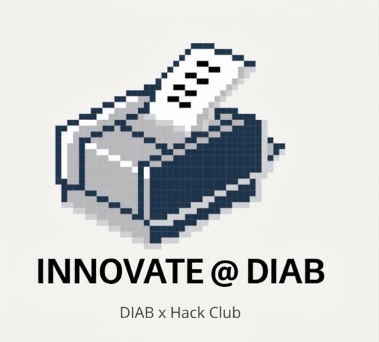

# Hack Club @ DIAB

Once a week a bunch of us at Dubai International Academy Al Barsha sit down, pick something to build, and try to get it working before the bell. Sometimes it does. Sometimes it catches fire a little. Either way it goes in the gallery.

The gallery lives here: **https://innovatediab-gallery.dino.icu**

You don't need to know how to code. Most of us didn't when we started. You just need to be curious enough to break something and then fix it.

## What is Hack Club?

[Hack Club](https://hackclub.com) is a nonprofit network of high school coding clubs around the world. Students run the clubs, and nobody hands you a syllabus. You build things you actually want to build, like websites, games, apps, and hardware with real circuit boards in it.

Hack Club also runs programs where you ship a project and get something back for it (they call it "You Ship, We Ship"), and there's a huge global Slack full of teenagers making stuff. Have a look at [hackclub.com/clubs](https://hackclub.com/clubs/) to see what it's all about.

## Come hang out

- DIAB students (internal): we meet on Wednesday or Monday at lunch. We send the exact day via email each week.
- Other schools (external): we meet online every Friday at 4:00 PM GST (GMT+4).
- Visit our [club website](https://innovatediab.dino.icu/).
- Follow us on [TikTok](https://www.tiktok.com/@innovatediab) to see what we're up to.
- Follow us on [Instagram](https://www.instagram.com/innovateat_diab/) too.
- Watch us on [YouTube](https://www.youtube.com/@InnovateDIAB).
- DIAB students: sign up with the [DIAB InnovateXhackclub form](https://forms.cloud.microsoft/r/DDFd4ajd7E).
- Other schools: sign up on the [external sign-up form](https://forms.cloud.microsoft/r/8mtcDznam5).
- Make a free [GitHub account](https://github.com/signup) if you don't have one (you need to be 13 or older).
- Tell a club leader your username and we'll add you to the Innovate-DIAB organization.

## InnoBits

InnoBits show who does how much work and contributes most to the club. Every approved ship earns InnoBits, and bigger ships earn more. Projects still waiting for approval show as pending. The gallery counts everything automatically and shows everyone's total in the InnoBits section.

## Get your project on the wall

1. Make your project a public repo.
2. On the repo page, click the little gear next to **About** and add your workshop's topic. For BakeBuild that's `diab-hc-bakebuild`.
3. Write a one-line description in About. If your project is live somewhere, paste the link there too and a Live demo button shows up.
4. Want a nice picture on your card? Put a screenshot called `preview.png` at the top level of the repo.
5. Want it filed under the right category? Add one more topic: `type-web`, `type-game`, `type-cad`, `type-hardware` or `type-code`. We guess if you don't.
6. BakeBuild projects get a quick look from a club leader first. Hit **Submit a project** on the site and fill in the short form.

Building hardware (PCBs, circuits)? Throw your KiCad files, the code, and some photos in the repo. A photo of the board next to the one that didn't work is always popular.

## A README your project will thank you for

Everyone reads these before they decide whether to click on anything. A few lines go a long way:

- What it does, in plain words
- A screenshot or photo
- How to run it or build it
- What went wrong and what you'd do differently

## Ground rules

- Make your own stuff. If you borrowed code or got help, say so.
- Be nice to each other. We follow the [Hack Club Code of Conduct](https://hackclub.com/conduct/).
- Keep your phone number, address, passwords and API keys out of your repos. Seriously.

## For club leaders

Meeting info and the sign-up link are in `config.json` (`meeting` and `signupUrl`). Adding workshops and approving projects is covered in [SETUP.md](SETUP.md).

## Links

- Our GitHub organization: https://github.com/Innovate-DIAB
- Hack Club: https://hackclub.com
- Hack Club workshops: https://workshops.hackclub.com

Got an idea for what we should build next? Open an issue and tell us.
